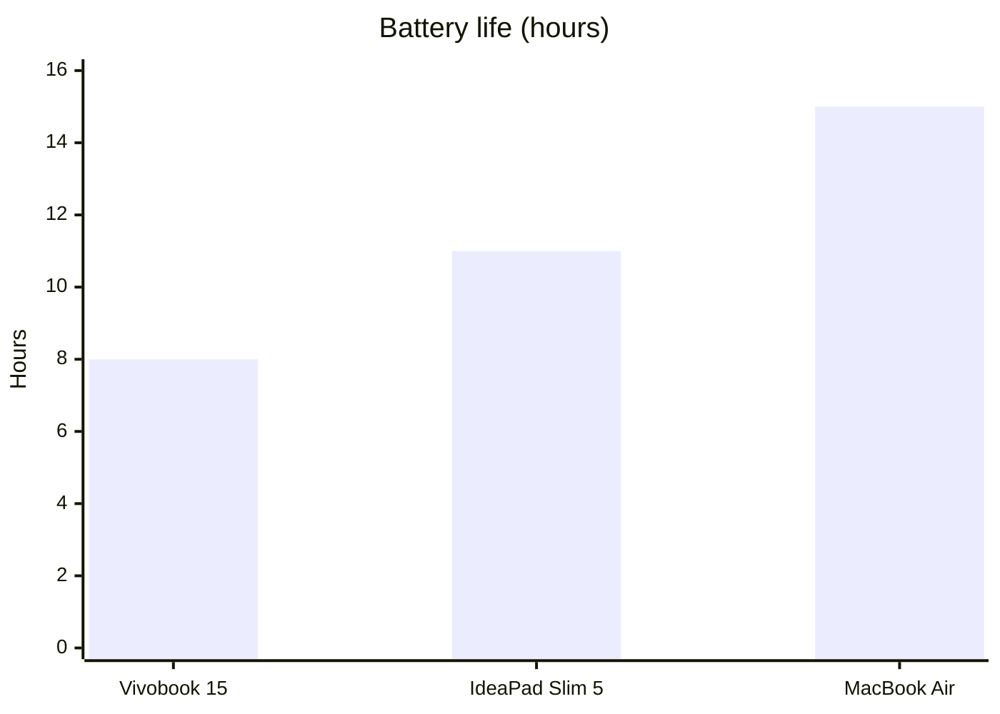

EXAMPLE: A COMPARISON

The request
"Compare three laptops for a student: price, weight and battery life."

The plan
A comparison is a table first. Numbers that differ a lot are easier to see as a chart. No figure skill: nobody asked for a drawing.
1. One line: the short answer.
2. Data table with the three laptops.
3. A Mermaid bar chart of battery life (Rich Markdown First shows how).
4. Who each one suits.

The calls, in order
1. open_skill Rich Markdown First (when it is listed), then its references/choosing-charts.md.
2. open_component Data.

The reply

For most students the IdeaPad Slim 5 is the best balance; the MacBook Air is worth the extra if you carry it all day.

```component
<Data>
  <Column key="verdict" as="Badge" colors="Best value:success, Lightest:tertiary, Cheapest:neutral" />
  <Row laptop="Vivobook 15" price="549" weightKg="1.7" batteryHours="8" verdict="Cheapest" />
  <Row laptop="IdeaPad Slim 5" price="699" weightKg="1.5" batteryHours="11" verdict="Best value" />
  <Row laptop="MacBook Air" price="999" weightKg="1.2" batteryHours="15" verdict="Lightest" />
</Data>
```



| If you | Pick |
|---|---|
| Mostly work at a desk and want to spend least | Vivobook 15 |
| Carry it to classes most days | IdeaPad Slim 5 |
| Are away from a socket all day | MacBook Air |

What made this answer work
- The answer came first, then the evidence.
- The chart shows the one number that differs most; the table holds the rest.
